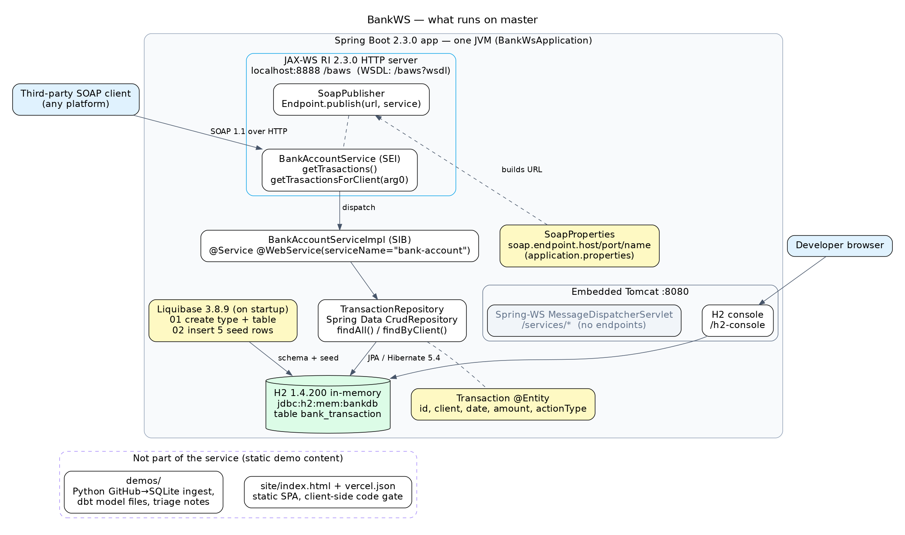

# BankWS

*BankWS* is spring-boot application that exposes a soap web service endpoint so third parties on different platforms can invoke
them via SOAP.

## Bussiness Case

A bank has many third-party application that need to access the user transaction history. The user transaction history is stored 
in the core system of the bank. The third-party applications are written with different technologies stack. We need to provide a way 
to expose the information from the core system of the bank in safe manner to all third-party application who need this information.

## Architecture

See [docs/architecture.md](docs/architecture.md) for how the service is wired together, the live SOAP contract and what else is in this repository.



## Repository layout

| Path | Contents |
|------|----------|
| `src/` | The BankWS Spring Boot SOAP service and its tests |
| `site/` | Static "Devin for Data Engineering" demo page (`index.html`, `vercel.json`); not used by the service |
| `demos/` | Barclays EDP demo artifacts (Python ingestion, dbt models, pipeline triage); see [demos/README.md](demos/README.md) |
| `docs/` | Architecture doc and diagram source |

## Technology

BankWS is using the following technologies:
- Java [version: 11] (the language used to write the application; build with JDK 11, because Lombok 1.18.12 fails to compile on newer JDKs such as 21)
- Maven [version:3.6] (the tool for managing dependencies and building the project) 
- Lombok [version:1.18.12] (the java library for removing boiler plate code from pojos)
- Spring-Boot [version:2.3.0.RELEASE] (the framework for creating spring application that just run)
- Spring-Data [version:2.3.0.RELEASE] (the framework for interacting with database)
- H2 Database [version:1.4.200] (the database we use for storing the information in development enviroment)
- Liquibase [version:3.8.9] (the tool for keeping the version control for relational databases)
- JAX-WS [version:2.3.0] (the library for exposing soap web service endpoints)

 ## Implementation Details
 
JAX-WS is an API for producing and consuming REST-style and SOAP-style web services. The @WebService annotation marks the POJO class 
as a web service, and the @WebMethod annotation specifies which of the encapsulated methods is a service operation. In a class annotated as a @WebService, a public instance
method is thereby a service operation even if the method is not annotated.

Below are the SEI (Service Endpoint Interface) and SIB (Service Implementation Bean):
```
@WebService
public interface BankAccountService {
	
	@WebMethod
	public List<Transaction> getTrasactions();
	
	@WebMethod
	public List<Transaction> getTrasactionsForClient(@WebParam String client);

}
```
The *BankAccountService* is the SEI and specifies the service operations.

```
@Service
@WebService(serviceName = "bank-account", endpointInterface = "com.github.rshtishi.bankws.service.BankAccountService")
public class BankAccountServiceImpl implements BankAccountService {
	
	@Autowired
	private TransactionRepository transactionRepository;
	
	@WebMethod(operationName="getTransactions")
	@Override
	public List<Transaction> getTrasactions() {
		List<Transaction> transactions = transactionRepository.findAll();
		return transactions;
	}

	@WebMethod(operationName="getTransactionsForClient")
	@Override
	public List<Transaction> getTrasactionsForClient(@WebParam(name="client") String client) {
		List<Transaction> transactions = transactionRepository.findByClient(client);
		return transactions;
	}

}
```
*BankAccountServiceImpl* is SIB that provides the implementation of the operations specified in SEI.

Because the SIB sets `endpointInterface`, JAX-WS builds the WSDL from the SEI and ignores the `operationName`/`name` values on the SIB. The published operations are therefore `getTrasactions` and `getTrasactionsForClient`, and the client parameter element is `arg0`.

Below we publish the endopoint for the *BankAccountService* SOAP-based web service:
```
@Configuration
public class SoapPublisher {

	private BankAccountService bankAccountService;
	private SoapProperties soapProperties;

	@Autowired
	public SoapPublisher(BankAccountService bankAccountService, SoapProperties soapProperties) {
		this.bankAccountService = bankAccountService;
		this.soapProperties = soapProperties;
		final String url = this.createUrl();
		Endpoint.publish(url, this.bankAccountService);
	}
	
	private String createUrl() {
		StringBuilder builder = new StringBuilder("http://");
		builder.append(this.soapProperties.getEndpoint().getHost());
		builder.append(":");
		builder.append(this.soapProperties.getEndpoint().getPort());
		builder.append("/");
		builder.append(this.soapProperties.getEndpoint().getName());
		return builder.toString();
	}
}
```

In the application.properties file you can modify the url when you want to endpoint to be published:
```
#SOAP
soap.endpoint.host=localhost
soap.endpoint.port=8888
soap.endpoint.name=baws
```

## Setting up the project
 
 - Clone the repository: ```git clone https://github.com/COG-GTM/BankWS.git```
 - Use JDK 11 (for example `export JAVA_HOME=/usr/lib/jvm/java-11-openjdk-amd64`).
 - Build and run the tests: ```sh mvnw clean install``` (or ```mvn clean install```). `mvnw` is committed without the executable bit, so call it through `sh`.
 - Run the application: ```sh mvnw spring-boot:run```
 - Open the WSDL at ```http://localhost:8888/baws?wsdl``` to check that the application started. The H2 console is at ```http://localhost:8080/h2-console```.
 - Call an operation, for example:
   ```
   curl -s -H 'Content-Type: text/xml; charset=utf-8' -H 'SOAPAction: ""' http://localhost:8888/baws -d '<soapenv:Envelope xmlns:soapenv="http://schemas.xmlsoap.org/soap/envelope/" xmlns:ser="http://service.bankws.rshtishi.github.com/"><soapenv:Body><ser:getTrasactionsForClient><arg0>kbalaj</arg0></ser:getTrasactionsForClient></soapenv:Body></soapenv:Envelope>'
   ```
