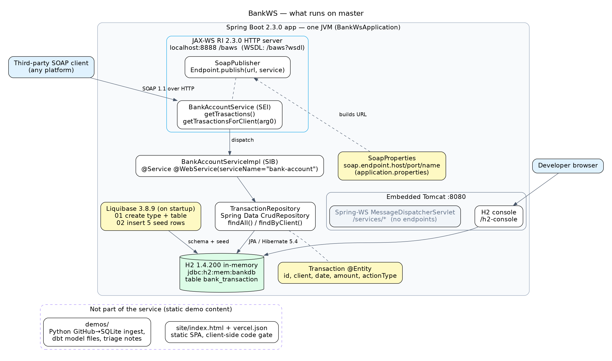

# BankWS architecture

This page describes what the code on `master` does today. Source of the diagram: [`diagrams/architecture.dot`](diagrams/architecture.dot) (Graphviz); re-render with [`diagrams/render.sh`](diagrams/render.sh).



## What is in the repository

| Path | What it is | Runs with the service? |
|------|------------|------------------------|
| `src/main/java/com/github/rshtishi/bankws/` | Spring Boot 2.3.0 app that publishes one JAX-WS SOAP endpoint | Yes |
| `src/main/resources/application.properties` | Datasource, Liquibase and `soap.endpoint.*` settings | Yes |
| `src/main/resources/db/` | Liquibase master changelog and two changesets | Yes (on startup) |
| `src/test/java/` | Three `@SpringBootTest` classes (6 tests) | Build only |
| `site/` | Static single-page "Devin for Data Engineering" demo (`index.html`) and `vercel.json` | No |
| `demos/` | Barclays EDP demo artifacts: Python ingestion scripts, dbt model files, triage notes | No |

`site/` and `demos/` do not call the service and the service does not use them.

## The SOAP service

### Startup

1. `BankWsApplication` starts Spring Boot. Embedded Tomcat listens on **8080**.
2. Liquibase runs `db/liquibase-changelog.xml` against the in-memory H2 database `jdbc:h2:mem:bankdb`:
   - `01-create-transaction-scheme.xml` creates the enum type `action_type ('Withdraw','Deposit')` and table `bank_transaction` (`id`, `client` varchar(30), `date`, `amount`, `action_type`).
   - `02-data-insert-transaction.xml` inserts 5 seed rows (clients `rshtishi` ×3, `kbalaj`, `vtafaj`).
   Hibernate does not touch the schema (`spring.jpa.hibernate.ddl-auto=none`). Data is lost on every restart.
3. `SoapConfiguration` registers `SoapProperties` (`soap.endpoint.host`, `.port`, `.name`).
4. `SoapPublisher` (a `@Configuration`) builds `http://<host>:<port>/<name>` in its constructor and calls `javax.xml.ws.Endpoint.publish(url, bankAccountService)`. This starts the JAX-WS RI's own HTTP server, separate from Tomcat. With the committed properties the endpoint is `http://localhost:8888/baws`, bound to 127.0.0.1 only.

### Request path

```
SOAP client --SOAP 1.1/HTTP--> JAX-WS server :8888/baws
   --> BankAccountServiceImpl (SIB)
   --> TransactionRepository (Spring Data CrudRepository)
   --> Hibernate 5.4 --> H2 table bank_transaction
```

| Class | Role |
|-------|------|
| `service.BankAccountService` | `@WebService` Service Endpoint Interface (SEI). Defines the WSDL contract. |
| `service.BankAccountServiceImpl` | `@Service` + `@WebService(serviceName="bank-account", endpointInterface=...)` Service Implementation Bean. Delegates to the repository. |
| `repository.TransactionRepository` | `findAll()` and the derived query `findByClient(String)`. |
| `entity.Transaction` | JPA entity on `bank_transaction`: `int id`, `String client`, `LocalDateTime date`, `double amount`, `ActionType actionType`. |
| `enums.ActionType` | `WITHDRAW`, `DEPOSIT`. |
| `config.SoapPublisher`, `SoapConfiguration`, `SoapProperties` | Endpoint publication and its configuration. |

### The live contract

Because the SIB names an `endpointInterface`, the WSDL comes from the SEI, so the operation names are the SEI method names (the `@WebMethod(operationName=...)` and `@WebParam(name=...)` on the implementation are ignored):

| Item | Value |
|------|-------|
| Service | `bank-account` |
| Target namespace | `http://service.bankws.rshtishi.github.com/` |
| Address | `http://localhost:8888/baws` (WSDL at `?wsdl`, schema at `?xsd=1`) |
| Operation | `getTrasactions` — no input, returns every row |
| Operation | `getTrasactionsForClient` — input element `arg0` (client name), returns that client's rows |
| Result element | `return` (repeated): `actionType`, `amount`, `client`, `date`, `id` |

Example request:

```xml
<soapenv:Envelope xmlns:soapenv="http://schemas.xmlsoap.org/soap/envelope/"
                  xmlns:ser="http://service.bankws.rshtishi.github.com/">
  <soapenv:Body>
    <ser:getTrasactionsForClient><arg0>kbalaj</arg0></ser:getTrasactionsForClient>
  </soapenv:Body>
</soapenv:Envelope>
```

Response (abridged): `<return><actionType>DEPOSIT</actionType><amount>700.0</amount><client>kbalaj</client><date/><id>4</id></return>`.
Calling `getTransactions` (correct spelling) returns the fault `Cannot find dispatch method`.

### Other things listening

- **H2 console** at `http://localhost:8080/h2-console` (`spring.h2.console.enabled=true`), using the datasource settings in `application.properties`.
- **Spring-WS** `MessageDispatcherServlet` at `/services/*`, registered by `spring-boot-starter-web-services` auto-configuration. No Spring-WS endpoints are defined, so it serves nothing useful.
- There are no REST controllers; `http://localhost:8080/` returns 404.

### Security

There is no authentication, authorization or TLS on the SOAP endpoint. It is only reachable from the same host because it binds to `localhost`.

## Build and tests

- Maven project, parent `spring-boot-starter-parent` 2.3.0.RELEASE, `java.version` 11. Maven wrapper pins Maven 3.6.3.
- Key libraries: JAX-WS RI 2.3.0 (`jaxws-rt`), Spring Data JPA / Hibernate 5.4.15, Liquibase 3.8.9, H2 1.4.200, Lombok 1.18.12.
- The build needs **JDK 11**. Lombok 1.18.12 cannot run on newer JDKs (on JDK 21 compilation fails with `IllegalAccessError ... jdk.compiler does not export com.sun.tools.javac.processing`).
- Tests (`mvn test`): `BankWsApplicationTests` (context loads), `BankAccountServiceImplTest` (5 rows total; first `rshtishi` row is id 1 / 500.0), `SoapPropertiesTest` (host/port/name). They start the full context, so they also publish the endpoint on port 8888.

## Demo content (`site/`, `demos/`)

- `site/index.html` is a self-contained page with three tabs (Ingestion, dbt Transform, Pipeline Triage) behind a 4-digit access gate checked in client-side JavaScript (also unlockable with a `?code=` query parameter). `vercel.json` serves the folder as static files and rewrites every path to `index.html`.
- `demos/demo1_ingestion/` — `ingest_repos.py` pulls the `dbt-labs` GitHub org's repositories from the public GitHub API into SQLite table `raw_repos` (`raw_repos.db`); `ingest_repos_v2_schema_change.py` adds a `forks_count` column. Python 3.9+ standard library only; unauthenticated GitHub API calls are rate-limited.
- `demos/demo2_dbt_transform/` — `raw_customers.sql`, `customers.sql` and `schema.yml` are dbt model files that `ref()` `stg_customers`, `stg_orders` and `stg_payments`. There is no `dbt_project.yml` or staging models in the repo, so they are illustrations, not a runnable dbt project.
- `demos/demo3_pipeline_triage/` — broken and fixed versions of two models plus `triage_analysis.md`.

See [`demos/README.md`](../demos/README.md) for the demo walkthrough.
